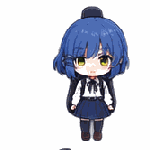

  

<h1 align="center"><a href="https://byzhaoran.github.io/BYzhaoran/">Hi, I'm BYzhaoran (Wenzhao Wang) 👋</a></h1>

  

---

## Profile

I build robotic systems across **perception, learning, control, and deployment**. My current focus is embodied manipulation: connecting stereo vision, imitation learning, VLA policies, classical control, and edge execution into reliable closed-loop systems.

My learning repository contains **300+ Markdown notes**, **60+ paper records**, and engineering notes spanning robot kinematics, dynamics, state estimation, ROS2, navigation, computer vision, reinforcement learning, simulation, sim-to-real, and embedded systems.

> Build the model, close the loop, verify it on hardware.

---

## 📊 Statistics & Contribution

  
  

<picture>
  <source media="(prefers-color-scheme: dark)" srcset="https://raw.githubusercontent.com/BYzhaoran/BYzhaoran/output/github-snake-dark.svg" />
  <source media="(prefers-color-scheme: light)" srcset="https://raw.githubusercontent.com/BYzhaoran/BYzhaoran/output/github-snake.svg" />
  
</picture>

---

  <a href="https://github.com/BYzhaoran">
    
    
    
    
     
    
    
    
     
    
    
    
  </a>

---

## 🔬 Research & Interest Areas

- <b>Robot Manipulation</b>: Imitation learning, ACT, diffusion policies, VLA, action chunks, failure recovery, and task progress.
- <b>Vision-Proprioception</b>: Stereo features, depth perception, visual representations, camera geometry, and modality cooperation.
- <b>Learning & World Models</b>: Reinforcement learning, Dreamer-style world models, sim-to-real transfer, and policy robustness.
- <b>Control & Planning</b>: Kinematics, dynamics, trajectory planning, PID, SMC, ADRC, LQR, MPC, and whole-body control.
- <b>Robotics Systems</b>: ROS2, Isaac Sim, Gazebo, MuJoCo, Genesis, embedded control, and edge inference.

---

## 🛠️ Tech Stack

    
    
    

 

| Category | Tools & Technologies |
| :--- | :--- |
| **Microcontrollers** | STM32 (F4/H7), MSPM0G350x, ESP32, 51 |
| **Edge & Sensors** | Jetson Nano, Raspberry Pi 5, Orbbec Gemini2, ASR Pro |
| **AI & Models** | Deformable DETR, YOLO Series, Whisper ASR, DeepSeek-V2, Reinforcement Learning |
| **Robotics & Simulation** | ROS2 Humble, Isaac Sim, Gazebo, MuJoCo, Genesis, robot modeling & sim-to-real workflows |
| **Control Algorithms** | PID, SMC, ADRC, LQR, MPC, motion control, trajectory optimization |
| **Languages** | Python, C, C++, Embedded C, MATLAB/Simulink, JavaScript |

---

## 🧩 Experience

### 🤖 RoboMaster Engineering Robot Lead
- Led the engineering robot control system development, designed the chassis motion control framework, and packaged core modules for an embedded engineering implementation.
- Built a multi-task control system on STM32 + FreeRTOS, covering motor drivers, PID closed-loop control, forward/inverse kinematics, and trajectory tracking.
- Drove system integration and performance tuning to improve motion stability and control accuracy.
- Won 1st Prize in the RMUL 2026 Sichuan Engineering Challenge; the team reached RMUC South Division in its first year and placed 12th in the group.

### 🦾 Orbbec Technology Group — R&D Engineer Intern
- Integrated Orbbec depth-vision devices with the LeRobot imitation learning framework, including perception module access, data collection pipeline setup, and system validation.
- Built multi-scenario experiments to compare depth vision and RGB vision solutions, analyzing how perception modalities affect imitation learning performance, environment understanding, and task generalization.
- Received an Orbbec internship certificate after 6 months of work; open-source contributions were adopted and cited in Seeed Studio’s official Wiki.

### 🤖 Knowin Intelligence  — Robotics algorithm Intern
- Worked on Knowin World robotics systems, covering navigation and simulation integration, skill workflows, and embodied manipulation policy deployment.
- Supported washer-task pipelines from perception and data collection to policy inference, control, and execution debugging.

### 🧪 Current Engineering Focus
- Building an end-to-end washer manipulation workflow: data collection, dataset validation, action representation, policy training, cloud inference, board-side adaptation, and execution safety checks.
- Exploring stereo-conditioned action policies, qpos/delta action representations, receding-horizon execution, trajectory sanity checks, and sim-to-real deployment.

### 🏆 Hackathon & Project Practice
- Participated in multiple hackathons and robotics competitions, continuously sharpening the full workflow from solution design and algorithm validation to engineering integration.
- Worked on embodied intelligence, imitation learning, and robot control projects across perception, decision-making, planning, and execution.

---

## 🚀 Highlighted Projects

| Project | Description | Tech |
| :--- | :--- | :--- |
| **🧠 RebotArm Embodied Intelligence Manipulation System** | End-to-end robot manipulation system with ACT imitation learning, VLA task planning, and Orbbec depth perception | Python, ACT, VLA, Orbbec, ROS2 |
| **🧺 Washer Manipulation Workflow** | Data-to-deployment pipeline for door opening/closing, including stereo perception, qpos policies, action chunks, cloud inference, and edge execution | Python, PyTorch, ONNX, ROS2 |
| **🤖 World Model & RL Study** | DreamerV3-based world model and reinforcement learning exploration for embodied decision making | Python, DreamerV3, RL |
| **🧊 AI Voice Smart Fridge** | Multimodal system combining YOLO detection, Whisper ASR, TTS & LLM | Python, YOLO, Whisper |
| **📐 Control Algorithm Suite** | Engineering validation & comparison of SMC, ADRC, LQR, and MPC | MATLAB, Simulink, Embedded C |
| **🌐 Depth Camera Integration** | Adapted Orbbec Gemini2 for ROS-based embodied AI perception pipelines | C++, ROS2, Python |

> ✅ All projects are publicly listed on [GitHub](https://github.com/BYzhaoran?tab=repositories) — dynamically synced via API on the [Projects page](https://byzhaoran.github.io/BYzhaoran/pages/projects.html).

## 📚 Knowledge Base

The accompanying notes are organized around a reusable robotics workflow:

`robot foundations → perception → planning & control → learning → simulation → deployment`

- **Foundations**: kinematics, dynamics, coordinate transforms, state estimation, trajectory planning, and whole-body control.
- **Perception**: camera models, multi-view geometry, detection, segmentation, stereo, and depth sensing.
- **Learning**: imitation learning, ACT, diffusion policy, VLA, reinforcement learning, and world models.
- **Systems**: ROS2 communication, navigation, embedded drivers, RTOS, model formats, simulation, and sim-to-real.
- **Research**: paper reviews and ongoing work on observation gaps, counterfactual analysis, adaptive policies, and efficient deployment.

The notes are maintained as working material: concise conclusions, implementation constraints, experiment records, and deployment lessons.

---

## 🎯 Goals

- 🤖 Develop reliable **embodied manipulation** systems from data to hardware.
- 🔬 Combine **classical control**, **robot learning**, and **foundation models**.
- ⚙️ Improve real-time inference, safety, observability, and sim-to-real transfer.
- 🌐 Keep the personal knowledge base and engineering notes open at [BYzhaoran](https://byzhaoran.github.io/BYzhaoran/).

---

## 📫 Contact Me

  
  
  

  

